# TripMate — Travel Planning Application

TripMate adalah aplikasi mobile berbasis Flutter yang membantu pengguna menjelajahi destinasi wisata, melihat informasi cuaca, menyimpan destinasi favorit, dan mengelola rencana perjalanan.

Project ini dikembangkan sebagai pemenuhan Ujian Tengah Semester (UTS) mata kuliah Pemrograman Mobile.

## Identitas Pengembang

- **Nama:** Komang Widyasari Devi
- **NIM:** 2415051078
- **Kelas:** PTI-5A
- **Tema Project:** Travel & Trip Planning
- **Repository:** https://github.com/widyasaridevi-code/TripMate

## Fitur Aplikasi

1. **Home:** Menampilkan halaman utama dan rekomendasi destinasi wisata.
2. **Explore:** Menjelajahi destinasi wisata dengan fitur pencarian dan filter kategori.
3. **Destination Detail:** Menampilkan informasi detail mengenai destinasi wisata.
4. **Weather Information:** Menampilkan informasi cuaca destinasi menggunakan REST API.
5. **Favorites:** Menyimpan dan mengelola destinasi wisata favorit.
6. **My Trips:** Membuat, melihat, mengedit, dan menghapus rencana perjalanan.
7. **Trip Detail:** Menampilkan detail rencana perjalanan yang dipilih.
8. **Profile:** Mengelola informasi dan preferensi profil.
9. **Responsive Layout:** Mendukung tampilan mobile dan desktop.

## Tech Stack

Teknologi dan tools yang digunakan dalam pengembangan aplikasi:

- **Flutter:** Framework pengembangan aplikasi mobile.
- **Dart:** Bahasa pemrograman.
- **Provider:** State management.
- **ChangeNotifier:** Mengelola perubahan state aplikasi.
- **SharedPreferences:** Penyimpanan data lokal.
- **Supabase:** Backend service dan database.
- **PostgreSQL:** Sistem manajemen database relasional.
- **REST API:** Mengambil data cuaca dari layanan eksternal.
- **HTTP:** Melakukan komunikasi dengan REST API.
- **Git & GitHub:** Version control dan penyimpanan repository project.

## REST API

TripMate menggunakan **Open-Meteo API** untuk mengambil informasi cuaca berdasarkan koordinat destinasi wisata.

**API Endpoint:**

https://api.open-meteo.com/v1/forecast

Data yang digunakan:
- Temperature
- Wind speed
- Weather code

Response JSON dari API diproses menjadi objek `WeatherModel`, kemudian ditampilkan pada UI aplikasi.

Aplikasi juga menyediakan kondisi loading dan error ketika proses pengambilan data berlangsung atau mengalami kegagalan.

## Backend & Database

TripMate menggunakan Supabase sebagai backend service dengan PostgreSQL sebagai database.

Database digunakan untuk menyimpan dan mengelola data rencana perjalanan pengguna.

Operasi database yang diterapkan:

- **Create:** Menambahkan rencana perjalanan baru.
- **Read:** Mengambil dan menampilkan data perjalanan.
- **Update:** Mengubah informasi rencana perjalanan.
- **Delete:** Menghapus rencana perjalanan.

Pengelolaan data menggunakan repository dan provider agar proses pengambilan serta perubahan data terpisah dari tampilan UI.

## State Management

Aplikasi menggunakan Provider dan ChangeNotifier untuk mengelola state.

Penerapannya meliputi:
- Mengelola data rencana perjalanan.
- Memperbarui tampilan ketika data berubah.
- Mengelola status loading.
- Menangani error ketika proses pengambilan atau penyimpanan data gagal.
- Menghubungkan data antara provider, repository, dan UI.

## Architecture

Struktur utama project:

```text
lib/
├── models/
├── providers/
├── repositories/
├── screens/
├── services/
├── widgets/
├── theme/
└── main.dart
```

Alur arsitektur aplikasi:

```text
UI / Screens
     ↓
Provider / ChangeNotifier
     ↓
Repository
     ↓
Service / Data Source
     ↓
REST API / Supabase Database
```

Penjelasan:
- **Models:** Menyimpan struktur dan representasi data.
- **Providers:** Mengelola state aplikasi.
- **Repositories:** Mengatur sumber dan proses pengelolaan data.
- **Services:** Menangani komunikasi dengan API dan backend.
- **Screens:** Menampilkan halaman aplikasi.
- **Widgets:** Menyediakan komponen UI yang dapat digunakan kembali.
- **Theme:** Mengatur tema dan tampilan aplikasi.

## Navigation

TripMate menggunakan navigasi utama untuk berpindah antarhalaman aplikasi.

Pada layar berukuran kecil, aplikasi menggunakan Bottom Navigation.

Pada layar yang lebih lebar, aplikasi menggunakan NavigationRail.

Aplikasi juga menerapkan navigasi dari daftar destinasi menuju halaman detail dengan mengirimkan data destinasi yang dipilih.

## Responsive Layout

Aplikasi memiliki dua kondisi tampilan:

- **Compact Layout:** Menggunakan Bottom Navigation untuk layar berukuran kecil.
- **Wide Layout:** Menggunakan NavigationRail untuk layar yang lebih lebar.

Selain itu, tampilan daftar destinasi pada halaman Explore menyesuaikan jumlah kolom berdasarkan lebar layar.

Dengan penerapan responsive layout, tampilan aplikasi dapat menyesuaikan ukuran layar mobile maupun desktop.

## Screenshots

### 1. Home

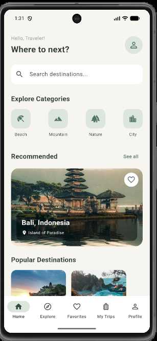

### 2. Explore

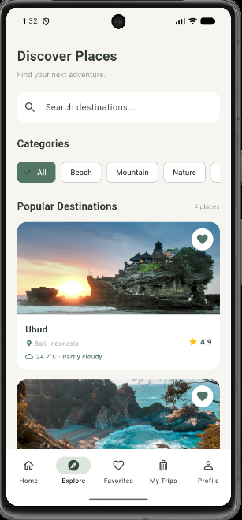

### 3. Destination Detail

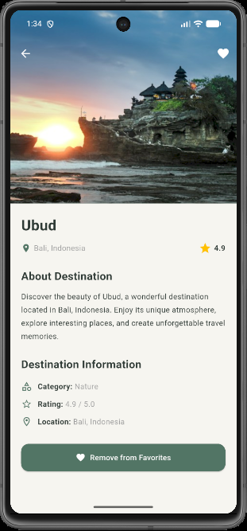

### 4. Add Trip

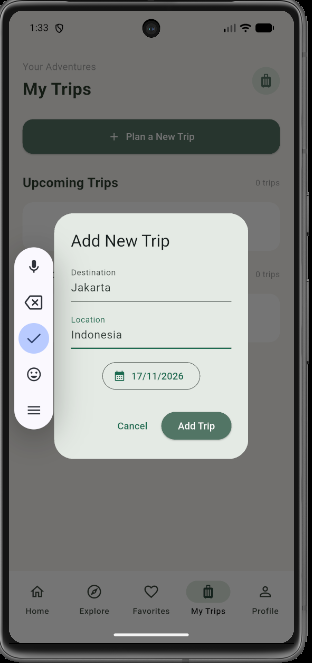

### 5. Edit Trip

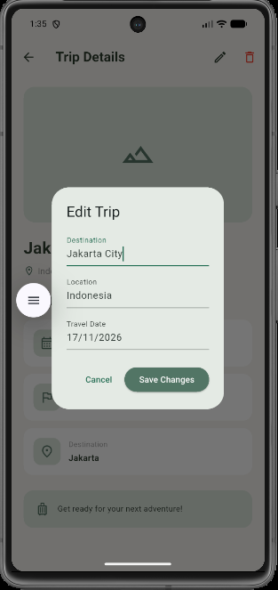

### 6. My Trips

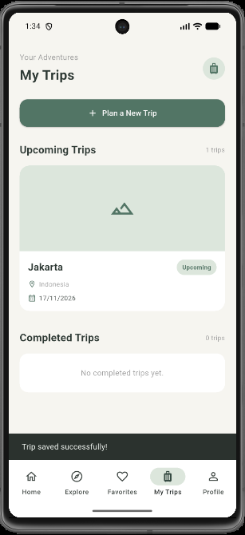

### 7. Favorites

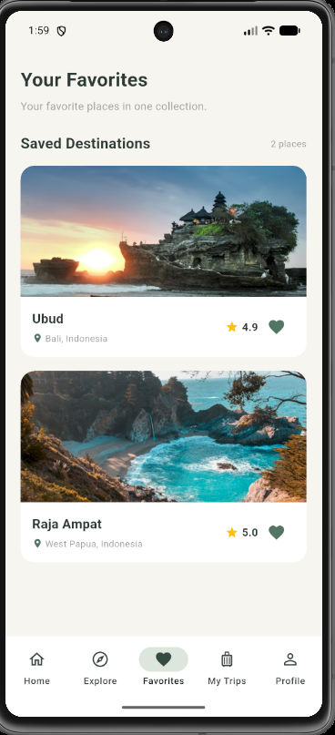

### 8. Profile

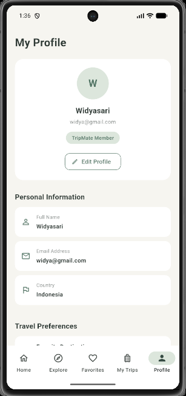

### 9. Responsive Layout

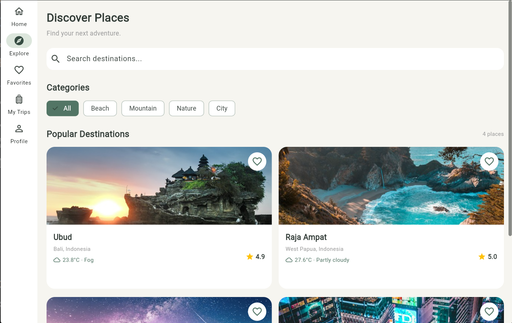

### 10. Weather API

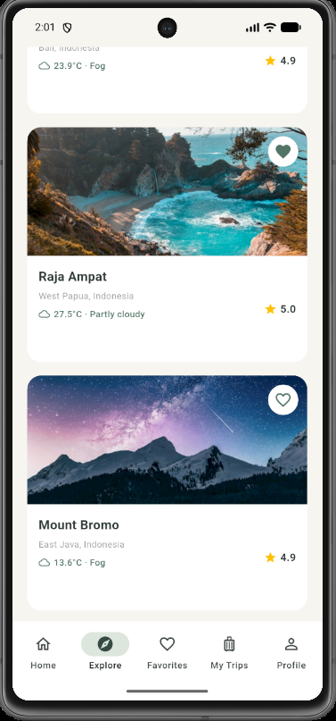

### 11. Supabase Database

Tambahkan screenshot tabel database Supabase pada bagian ini setelah mengambil screenshot.

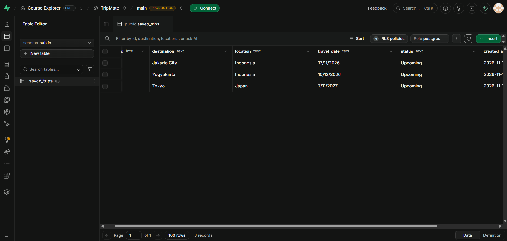

## Cara Menjalankan Project

### 1. Clone Repository

```bash
git clone https://github.com/widyasaridevi-code/TripMate.git
```

### 2. Masuk ke Folder Project

```bash
cd TripMate
```

### 3. Install Dependencies

```bash
flutter pub get
```

### 4. Konfigurasi Supabase

Pastikan konfigurasi Supabase sudah disesuaikan dengan project dan credential milik sendiri.

Jangan mengunggah password, service_role key, private key, atau credential sensitif ke repository publik.

### 5. Jalankan Aplikasi

```bash
flutter run
```

### 6. Periksa Kualitas Kode

```bash
flutter analyze
```

## Pengujian Aplikasi

Pengujian dilakukan secara manual untuk memastikan fitur utama aplikasi berjalan dengan baik.

Beberapa fitur yang diuji meliputi:

- Navigasi antarhalaman.
- Pencarian dan filter destinasi.
- Menampilkan detail destinasi.
- Menambahkan dan menghapus destinasi favorit.
- Mengambil informasi cuaca dari REST API.
- Menambahkan rencana perjalanan.
- Melihat daftar dan detail perjalanan.
- Mengedit rencana perjalanan.
- Menghapus rencana perjalanan.
- Menyesuaikan tampilan pada ukuran layar berbeda.

## Developer

**Komang Widyasari Devi**

Project Ujian Tengah Semester (UTS)  
Mata Kuliah Pemrograman Mobile.